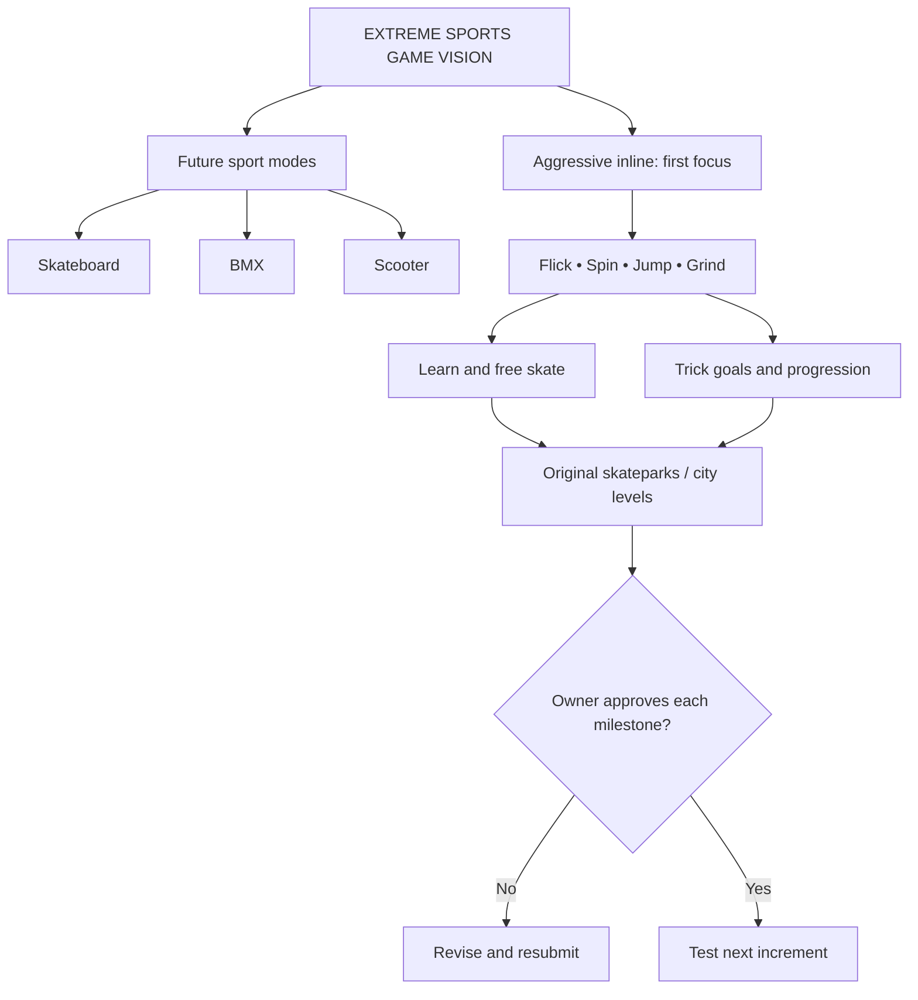
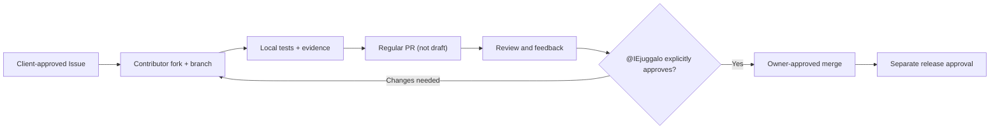

# SkateQuest — Project Vision & Client Brief

**Client / final approver:** @IEjuggalo  
**Contributor:** @justacalico  
**Document status:** Reference brief — vision preserved; individual implementation decisions require owner approval  
**Date:** 2026-11-15

> **Important:** This repository is currently a Flutter starter counter app, **not a playable skate game**. The owner has discussed a much larger extreme-sports game vision under working names such as **GRINDLINE / Finger Xtreme**. The separate [SkaterBladerBMXScoot concept repository](https://github.com/IEjuggalo/SkaterBladerBMXScoot) contains additional ideas. None of these names, feature outlines, or proposals automatically authorizes replacing existing code or publishing a product.

## Executive creative brief

**Product ambition:** Build an original, satisfying extreme-sports game that captures the physical feel of performing tricks with fingers: drag, release, flick, and spin. Aggressive inline skating is the first emphasized sport, with skateboarding, BMX, and scooters as additional modes. Focus on intuitive controls, responsive trick/grind detection, original art, and a replayable skatepark experience.

**Client priorities:** Preserve the creator's existing ideas and visual references, ship incrementally, demonstrate working results, keep it free-first, use legally redistributable assets, and obtain the owner's final sign-off before merge or release.

| Dimension | Established direction / current evidence | Not yet decided |
| --- | --- | --- |
| Code today | Flutter counter scaffold and widget tests in this repo | Whether this repo becomes the final game codebase |
| Core interaction | Finger-controlled extreme-sports gameplay; tactile gestures, ramps, rails and grinds | Exact gesture mapping, controls, and game engine |
| Sport order | Aggressive inline first; skating/BMX/scooter concepts also preserved | Exact first-slice mechanics and implementation order |
| Target experience | Mobile-friendly, instant restart, learning mode/tutorial, satisfying trick feedback | Specific device baseline, performance targets and art production |
| World concept | City-scale levels connected by paths and multiple parks/spots; Corona (two parks), Tempe and Casa Grande discussed | Verified park names/cross streets, level geometry, licensing of references |
| Later features | Goals, timed runs, tricks/scoring, customization, progression/unlocks, free skate, replay/video features and achievements | MVP inclusions, online functionality, monetization |
| Visuals | Expressive street/skatepark environments and bold street-art menus described in project planning | Actual approved game screenshots, models, sprites and final branding |

## Visual: product experience map

*The diagram conveys product direction, not a screenshot or a tested implementation.*

## Visual: review and delivery workflow

**Approval rule:** a green test, comment, automated review, or regular PR does **not** equal permission to merge or deploy. The owner makes the final decision. No auto-merge.

## Proposed first demonstration — requires review, not an approved build

Create a **small gesture-and-trick proof of concept** for aggressive inline on a simple original ramp/rail. Demonstrate one tactile finger-input sequence, a clearly visible jump or grind result, safe restart, and observable feedback (score or trick name). Keep the technology and art minimal and original. Before coding this, submit a specification and screen mockups for the owner's decision.

**Do not silently switch the game to a one-button auto-runner.** That runner proposal in PR #11 is currently under review and does not replace the previously discussed finger-controlled experience.

## Future level and art direction

The owner has discussed **each city as one larger playable level**, with several skateparks/spots connected by paths. Initial locations discussed: **Corona, California (two parks), Tempe, Arizona, and Casa Grande, Arizona**. Approach signs should use verified real park names and cross streets only after validation. They are **future scope**, not an instruction to create real-world maps or use copyrighted park photography now.

A hand-drawn spiral-headed skate mascot also exists as a separate creator-owned brand reference. **Do not reconstruct, upload, or replace that artwork** from memory. Request the precise approved source asset and explicit public-use permission before placing it in this public repo.

## Client deliverable standard

Each assignment should have:
1. **Written brief:** problem, intended audience, current state, desired outcome, exclusions and dependencies.
2. **Visual evidence:** a diagram, annotated wireframe, screenshot, short screen recording, or comparison board **when useful**, clearly labeled *concept* vs *tested build*.
3. **Acceptance criteria:** observable behaviors rather than “looks finished.”
4. **A GitHub Issue:** scope, priority, links, assigned contributor alias, and comments for progress or blockers.
5. **A regular pull request:** code/doc changes, test evidence, screenshots if UI changed, risk/rollback, and a link to its Issue.
6. **Owner decision:** explicit approval or requested changes before merge. Production or publication requires a separate approval.

Free or existing tools only unless the owner authorizes costs. Never include account credentials, private business data, unlicensed music/game art, BIOS files, or ROMs.

## Current work queue

- [#4 — Flutter CI](https://github.com/IEjuggalo/skatequest/issues/4)
- [#5 — Product/MVP scope](https://github.com/IEjuggalo/skatequest/issues/5) (pending owner direction; avoid runner substitution)
- [#6 — Contributor guide / PR template](https://github.com/IEjuggalo/skatequest/issues/6)
- [#7 — Widget / accessibility tests](https://github.com/IEjuggalo/skatequest/issues/7)
- [#8 — Asset and license policy](https://github.com/IEjuggalo/skatequest/issues/8)

## Getting references or feedback

- **Blocked, question, or progress update:** comment on the assigned Issue using [Contributor communication guide](./CONTRIBUTOR_COMMUNICATION.md).
- **Need a video, photo, approved design, slide deck, or source file:** describe the reference and intended use in the Issue. Do not independently source and redistribute materials without checking rights.
- **Work ready for review:** open a **regular PR** and link it; include screenshots or a short clip when visual behavior changed.
- **Security or personal-data concern:** do not paste secrets into public GitHub Issues; notify the owner privately through an established channel.

This public brief contains project direction and workflow only. Private business plans, personal contact details, and unapproved artwork remain outside the public repository.
